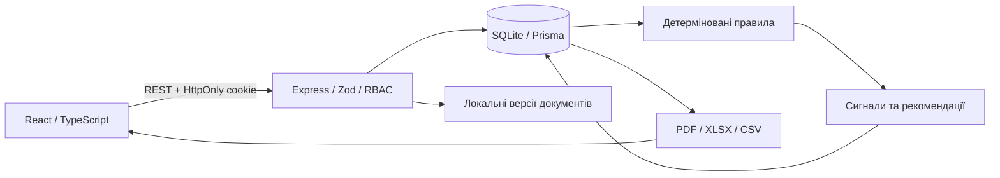

# Архітектура

## Потік даних

Один процес слухає `127.0.0.1:3000`. У розробці Vite вбудований у Express; у production Express віддає зібраний frontend. Окремого CORS-режиму немає.

## Дані та інваріанти

- `Program` має заходи й ризики. Захід можна пов’язати лише з ризиком обраної програми.
- `Activity` має активного виконавця, розділ, строки, індикатор, ціль і стан. Архівування не видаляє історію.
- `Risk` має власний показник і `RiskMeasurement`; оновлення заходу не підмінює вимірювання ризику.
- `Evidence` зберігає UUID-шлях, оригінальну назву, MIME, розмір, SHA-256, автора і версію. Унікальність: захід + назва + версія.
- `RiskFlag` і `Recommendation` мають унікальний ключ захід + правило. Коли причина зникає, запис стає неактивним.
- `Session` містить SHA-256 випадкового токена й дату завершення; відкритий токен — лише у cookie.
- `AuditLog` містить користувача, дію, об’єкт, час, попереднє й нове значення. Зміна виконання, коментар до нього та відповідна подія аудиту записуються однією транзакцією.

## Правила

| Код | Умова | Рекомендація |
|---|---|---|
| OVERDUE | Незавершений захід після контрольного строку | Пояснення та оновлений план |
| NO_EVIDENCE | На погодженні/виконано, документів немає | Запросити підтвердження |
| NO_MEASUREMENT | Виконано без числового результату | Внести вимірювання |
| NO_RISK_CHANGE | Виконано, показник ризику не покращився | Переглянути ефективність |
| TARGET_MISSED | Виконано, ціль заходу не досягнута | Додаткові дії |
| REPEATED_DELAY | Не менше двох змін контрольного строку | Переглянути ресурси й план |
| STALE | Незавершений захід без оновлень довше порога | Актуалізувати стан |
| NO_RESULT | Виконано без опису результату | Додати опис, перевірити відповідність меті |
| CLUSTER | Щонайменше два проблемні заходи одного ризику | Спільний перегляд заходів |

Правила `NO_MEASUREMENT` і `NO_RESULT` також захищають від неповних історичних/імпортованих записів; звичайна форма погодження не дозволяє такі пропуски.

## KPI

Усього — активні заходи програми; виконано — статус `COMPLETED`; у процесі — `IN_PROGRESS`; прострочено — строк минув і не `COMPLETED`; увага — хоча б один активний сигнал. Прогрес = виконано / усього × 100 (для порожньої програми 0%). Покращення ризику залежить від напряму `UP`/`DOWN` та порівняння поточного значення з початковим. Графік завершень групує фактичні дати погоджених заходів; графік плану — контрольні строки.

## API

| Маршрут | Призначення |
|---|---|
| `/api/auth/login`, `/demo`, `/me`, `/logout` | Сесії й демовхід |
| `/api/users`, `/api/programs` | Облікові записи та програми |
| `/api/activities` | Пошук, фільтри, пагінація, створення |
| `/api/activities/:id` | Деталі, редагування |
| `/api/activities/:id/progress`, `/archive`, `/comments` | Виконання, архів, коментарі |
| `/api/risks`, `/api/risks/:id/measurements` | Ризики й вимірювання |
| `/api/evidence`, `/api/evidence/:id/download` | Версії файлів |
| `/api/flags`, `/api/recommendations` | Сигнали, рішення |
| `/api/notifications` | Внутрішні нагадування |
| `/api/dashboard` | Агрегати та графіки |
| `/api/reports` | `programId`, `year`, `half`, `format` |
| `/api/audit` | Журнал або історія за `objectId` |
| `/api/settings`, `/api/demo/reset` | Налаштування й демоскидання |

Для розгортання на багато установ потрібні межі організацій, міграції PostgreSQL, черга аналізу, окреме сховище документів, пагінація всіх великих колекцій і версійовані затверджені звіти.
