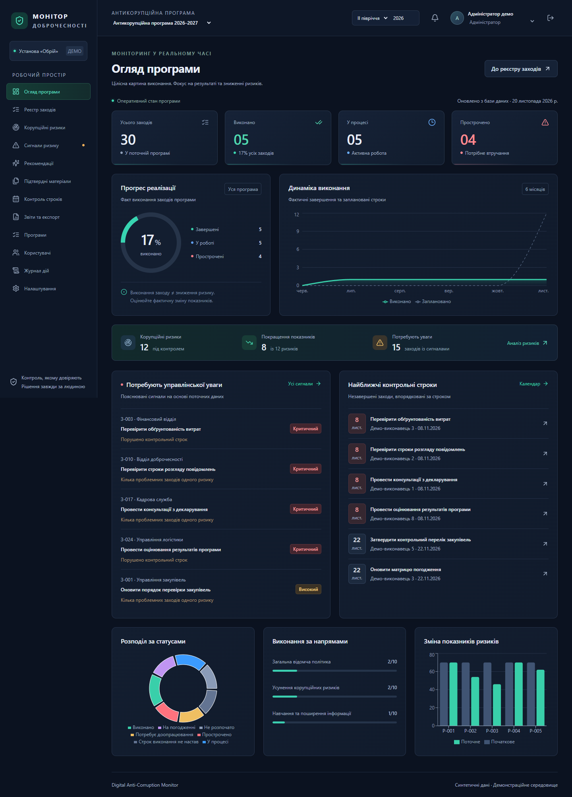
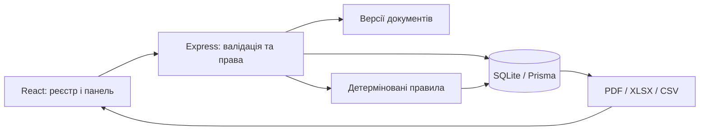

# Монітор доброчесності

Команда «VUI IT» · Завдання 2. Цифрова система моніторингу виконання антикорупційної програми

## Проблема і користувач

Координатори антикорупційних програм збирають результати з розрізнених таблиць і повторно вводять їх у звіти. Формальна позначка «виконано» не показує, чи досягнуто цілі й чи знизився корупційний ризик. Виконавцю потрібне одне місце для результату й документів, координатору — погодження та контроль строків, керівнику — пояснювані сигнали. Система окремо показує факт виконання, досягнення цілі заходу та зміну показника ризику.

## Що робить рішення

- Реєстр заходів із пошуком, фільтрами, календарем і п’ятьма ролями.
- Подання результату виконавцем → перевірка координатором → рішення керівника «Схвалено» або «Не схвалено» з обґрунтуванням у звіті.
- Версії документів PDF/DOCX/XLSX/PNG/JPG, SHA-256 та журнал аудиту.
- Окремі вимірювання корупційних ризиків, десять прозорих правил сигналів і рекомендації.
- Сповіщення про строки, подання на погодження та повернення на доопрацювання.
- Панель показників і піврічні звіти JSON, CSV, XLSX, PDF за трьома розділами.

## Демонстрація

Відео до 3 хвилин: **TODO(команда): записати та додати посилання з доступом без входу.**

Публічна робоча версія: немає; застосунок запускається локально. [Сценарій відео](docs/DEMO_SCRIPT.md).
Усі дані установи «Обрій» та користувачі — вигадані. Швидкий вхід працює лише з DEMO_MODE=true.

## Як запустити

Потрібні Git і **Node.js 24 LTS**. Для PDF — встановлений Arial (Windows) або DejaVu Sans (Linux).

1. Клонуйте репозиторій: `git clone https://github.com/avviva04-tech/hakaton.git`.
2. Перейдіть до нього: `cd hakaton`.
3. Встановіть залежності: `npm ci`.
4. Підготуйте базу: `npm run setup`.
5. Запустіть: `npm run dev` і відкрийте http://localhost:3000.

У Windows після клонування можна використати `powershell -NoProfile -ExecutionPolicy Bypass -File .\start.ps1`.

Налаштування створює локальний .env і випадковий DEMO_PASSWORD. У деморежимі форма входу містить лише кнопки ролей. Автоматичні та ручні тести входять через демонстраційний доступ без облікових даних. Паролі та база не входять до Git. Повторний setup зберігає дані; при першому переході зі старої версії замінює попередній демопароль випадковим і відкликає демосесії. Перед setup у Windows зупиніть сервер: Prisma використовує DLL.

Для збірки: `npm run build`, потім `npm start`. Для перевірок: `npm test`, `npm run test:reset`, `npm run test:browser`, `npm run format:check`. Тести самостійно запускають сервер на вільному порту з окремою тимчасовою БД і файлами. Браузерна перевірка використовує Microsoft Edge; інший канал задається BROWSER_CHANNEL.

## Як влаштовано

React 19 / TypeScript / Vite 7 / Tailwind 4 → Express 5 → Prisma 6 / SQLite. Node.js 24 запускає серверний TypeScript без транспіляції. Зовнішніх ШІ-сервісів у застосунку немає. **Система лише підсвічує проблеми; рішення ухвалює людина.**

Основні модулі: [роутери](server/src/routes/api.ts), [аналізатор](server/src/services/analyzer.ts), [агрегати панелі](server/src/services/dashboard.ts), [переходи станів](shared/domain.ts), [календарні дати Europe/Kyiv](shared/dates.ts), [схема БД](prisma/schema.prisma).

GET реєстру, панелі, календаря та сигналів читає дані. Перерахунок виконується після мутацій, при старті й раз на хвилину. Новий запит під час перерахунку очікує додаткового проходу. Стани «прострочено» й «строк не настав» обчислюються з дат; їх не можна встановити вручну.

| Код            | Умова                                                                                                              | Рекомендація                               | Пріоритет |
| -------------- | ------------------------------------------------------------------------------------------------------------------ | ------------------------------------------ | --------- |
| OVERDUE        | Незавершений захід: календарний строк раніше сьогодні за Києвом                                                    | Пояснення та оновлений план                | CRITICAL  |
| NO_EVIDENCE    | На погодженні або виконано без документа                                                                           | Надати підтвердження                       | HIGH      |
| NO_MEASUREMENT | Виконано без числового результату                                                                                  | Внести вимірювання                         | HIGH      |
| RISK_REMEASURE | Виконано, але немає вимірювання ризику після фактичної дати                                                        | Повторно виміряти ризик                    | MEDIUM    |
| NO_RISK_CHANGE | Останнє вимірювання після виконання не краще за останнє до початку; за відсутності історії — за початкове значення | Переглянути ефективність                   | HIGH      |
| TARGET_MISSED  | Виконано, числову ціль заходу не досягнуто                                                                         | Погодити додаткові дії                     | HIGH      |
| REPEATED_DELAY | Щонайменше два перенесення строку                                                                                  | Переглянути ресурси й план                 | MEDIUM    |
| STALE          | Незавершений захід без оновлень довше налаштованого порога (типово 30 днів)                                        | Актуалізувати дані                         | MEDIUM    |
| NO_RESULT      | Виконано без опису результату                                                                                      | Надати опис, перевірити відповідність меті | HIGH      |
| CLUSTER        | Захід має власний сигнал, а на тому самому ризику є ще хоча б один проблемний захід                                | Спільний перегляд заходів                  | HIGH      |

Архівні заходи не формують сигналів. Повторна поява проблеми відкриває її заново та поновлює строк рекомендації. SHA-256 перевіряє незмінність байтів, а не достовірність змісту. Це локальний демонстраційний MVP, без інтеграції з НАЗК, електронного підпису, SSO та антивірусу; звіт перевіряє людина.

## Документація

- [Архітектура](docs/ARCHITECTURE.md) — компоненти, дані, інваріанти та API.
- [Безпека](docs/SECURITY.md) — матриця прав і межі довіри.
- [Запобігання зловживанням](docs/ABUSE_PREVENTION.md) — сценарії ризиків і контрольні механізми.
- [Інтеграції](docs/INTEGRATION.md) — карта майбутнього обміну, без заяв про наявну інтеграцію.
- [Економія часу](docs/TIME_SAVINGS.md) — модель розрахунку й припущення.
- [Перевірки](docs/VERIFICATION.md) — результати тестів і обмеження.
- [Демонстрація](docs/DEMO_SCRIPT.md) — сценарій до трьох хвилин.
- [Використання ШІ](docs/ai.md) — інструменти, рішення й пункти для підтвердження командою.

TODO(команда): звірити матеріали з повним офіційним текстом «Очікуваний формат кінцевого продукту» завдання 2; у репозиторії цього тексту немає.

## Що використали

Ліцензії перевірено за package.json установлених прямих залежностей:

| Ліцензія     | Компоненти                                                                                                                                                                                                                                                                  |
| ------------ | --------------------------------------------------------------------------------------------------------------------------------------------------------------------------------------------------------------------------------------------------------------------------- |
| MIT          | React, React DOM, React Router, React Hook Form, @hookform/resolvers, Recharts, Zod, Express, express-rate-limit, cookie-parser, Helmet, Multer, file-type, ExcelJS, PDFKit, Vite, @vitejs/plugin-react, Tailwind CSS, @tailwindcss/vite, Prettier, archiver, пакети @types |
| Apache-2.0   | Prisma, @prisma/client, TypeScript, @playwright/test                                                                                                                                                                                                                        |
| BSD-3-Clause | bcryptjs                                                                                                                                                                                                                                                                    |
| BSD-2-Clause | dotenv                                                                                                                                                                                                                                                                      |
| ISC          | lucide-react                                                                                                                                                                                                                                                                |

Шрифти інтерфейсу беруться із системи: Inter → Segoe UI → Arial → sans-serif; файли шрифтів не розповсюджуються. PDF використовує встановлений Arial або DejaVu Sans відповідно до ліцензії цього шрифту.

ШІ під час розробки: у цій сесії — Codex; попередні інструменти та точні моделі **TODO(команда): підтвердити** в [декларації ШІ](docs/ai.md). У runtime ШІ-моделей немає.
