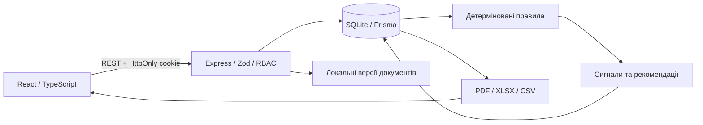

# Архітектура

## Потік даних

Один процес слухає `127.0.0.1:3000`. У розробці Vite вбудований у Express; у production Express віддає зібраний frontend. Окремого CORS-режиму немає.

## Дані та інваріанти

- `Program` має заходи й ризики. Захід можна пов’язати лише з ризиком обраної програми.
- `Activity` має активного виконавця, розділ, строки, індикатор, ціль і стан. Архівування не видаляє історію.
- `Risk` має власний показник і `RiskMeasurement`; оновлення заходу не підмінює вимірювання ризику.
- `Evidence` зберігає UUID-шлях, оригінальну назву, MIME, розмір, SHA-256, автора і версію. Унікальність: захід + назва + версія.
- `RiskFlag` і `Recommendation` мають унікальний ключ захід + правило. Коли причина зникає, запис стає неактивним.
- `Session` містить SHA-256 випадкового токена й дату завершення; відкритий токен — лише у cookie.
- `AuditLog` містить користувача, дію, об’єкт, час, попереднє й нове значення. Зміна виконання, коментар до нього та відповідна подія аудиту записуються однією транзакцією.

## Правила

| Код            | Умова                                                                                                              | Рекомендація                               | Пріоритет |
| -------------- | ------------------------------------------------------------------------------------------------------------------ | ------------------------------------------ | --------- |
| OVERDUE        | Незавершений захід: календарний строк раніше сьогодні за Києвом                                                    | Пояснення та оновлений план                | CRITICAL  |
| NO_EVIDENCE    | На погодженні або виконано без документа                                                                           | Надати підтвердження                       | HIGH      |
| NO_MEASUREMENT | Виконано без числового результату                                                                                  | Внести вимірювання                         | HIGH      |
| RISK_REMEASURE | Виконано, але немає вимірювання ризику після фактичної дати                                                        | Повторно виміряти ризик                    | MEDIUM    |
| NO_RISK_CHANGE | Останнє вимірювання після виконання не краще за останнє до початку; за відсутності історії — за початкове значення | Переглянути ефективність                   | HIGH      |
| TARGET_MISSED  | Виконано, числову ціль заходу не досягнуто                                                                         | Погодити додаткові дії                     | HIGH      |
| REPEATED_DELAY | Щонайменше два перенесення строку                                                                                  | Переглянути ресурси й план                 | MEDIUM    |
| STALE          | Незавершений захід без оновлень довше налаштованого порога (типово 30 днів)                                        | Актуалізувати дані                         | MEDIUM    |
| NO_RESULT      | Виконано без опису результату                                                                                      | Надати опис, перевірити відповідність меті | HIGH      |
| CLUSTER        | Захід має власний сигнал, а на тому самому ризику є ще хоча б один проблемний захід                                | Спільний перегляд заходів                  | HIGH      |

Правила `NO_MEASUREMENT` і `NO_RESULT` також захищають від неповних історичних/імпортованих записів; звичайна форма погодження не дозволяє такі пропуски.

## KPI

Усього — активні заходи програми; виконано — статус `COMPLETED`; у процесі — `IN_PROGRESS`; прострочено — строк минув і не `COMPLETED`; увага — хоча б один активний сигнал. Прогрес = виконано / усього × 100 (для порожньої програми 0%). Покращення ризику залежить від напряму `UP`/`DOWN` та порівняння поточного значення з початковим. Графік завершень групує фактичні дати погоджених заходів; графік плану — контрольні строки.

## API

| Маршрут                                                 | Призначення                           |
| ------------------------------------------------------- | ------------------------------------- |
| `/api/auth/login`, `/demo`, `/me`, `/logout`            | Сесії й демовхід                      |
| `/api/users`, `/api/programs`                           | Облікові записи та програми           |
| `/api/activities`                                       | Пошук, фільтри, пагінація, створення  |
| `/api/activities/:id`                                   | Деталі, редагування                   |
| `/api/activities/:id/progress`, `/archive`, `/comments` | Виконання, архів, коментарі           |
| `/api/risks`, `/api/risks/:id/measurements`             | Ризики й вимірювання                  |
| `/api/evidence`, `/api/evidence/:id/download`           | Версії файлів                         |
| `/api/flags`, `/api/recommendations`                    | Сигнали, рішення                      |
| `/api/notifications`                                    | Внутрішні нагадування                 |
| `/api/dashboard`                                        | Агрегати та графіки                   |
| `/api/reports`                                          | `programId`, `year`, `half`, `format` |
| `/api/audit`                                            | Журнал або історія за `objectId`      |
| `/api/settings`, `/api/demo/reset`                      | Налаштування й демоскидання           |

Для розгортання на багато установ потрібні межі організацій, міграції PostgreSQL, черга аналізу, окреме сховище документів, пагінація всіх великих колекцій і версійовані затверджені звіти.

## Оновлення 20.11.2026

Маршрути розділено за ресурсами у server/src/routes. Переходи статусів спільні для сервера й клієнта; Координатор переводить REVIEW у MANAGER_REVIEW за наявності документа; лише керівник переводить MANAGER_REVIEW у COMPLETED або REVISION. Обґрунтування, автор і дата рішення зберігаються в AuditLog та потрапляють до звітів. Строки обчислюються календарними днями Europe/Kyiv. Панель використовує count/groupBy; календар читає /api/calendar. GET аналітики не запускає перерахунок.
